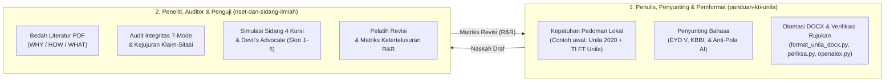

# Academic Writing & Research Skills for AI Agents

Koleksi **AI Agent Skills** siap pakai untuk membantu penyusunan, penyuntingan kaidah bahasa Indonesia (EYD V & KBBI), pemformatan dokumen `.docx`, verifikasi rujukan ilmiah, audit integritas klaim, hingga simulasi tanya-jawab sidang Karya Tulis Ilmiah (Skripsi, Tesis, Proposal, Laporan KP, dan Artikel Jurnal).

Repositori ini dirancang sebagai **ekosistem modular**: saat ini tersedia paket implementasi awal untuk **Universitas Lampung (Panduan KTI Unila 2020 & S1 Teknik Informatika FT Unila)** serta modul riset/sidang umum, dan disiapkan untuk dikembangkan lebih lanjut mencakup **panduan khusus antar-fakultas maupun antar-kampus**.

Kompatibel dengan **Google Antigravity**, **Claude Code / Claude Desktop**, **Codex CLI**, **OpenCode**, dan **Cursor**.

---

## Mengapa Proyek Ini Dibuat?

Penulisan karya ilmiah dengan bantuan AI sering menghadapi dua masalah utama:
1. **Format & bahasa melenceng dari pedoman lokal** — AI kerap memakai gaya bahasa klise, mengarang rujukan, atau gagal mematuhi detail teknis kampus (margin, penomoran halaman ganda, aturan titik pada judul tabel/gambar, dan gaya sitasi).
2. ***Cognitive Frame-Lock* & AI Terlalu Mengalah (*Sycophancy*)** — Jika AI yang sama menulis draf sekaligus menguji drafnya, ia cenderung membela tulisannya sendiri.

Repositori ini memisahkan peran menjadi **dua skill mandiri**:



---

## Daftar Skill yang Tersedia Saat Ini

| Skill | Cakupan | Lokasi | Keterangan |
| :--- | :--- | :--- | :--- |
| **`panduan-kti-unila`** | Format fisik & tata bahasa KTI | [`skills/panduan-kti-unila/`](skills/panduan-kti-unila/) | Menggabungkan kaidah EYD V/KBBI, pembuang pola tulisan AI, pemeriksa fakta (`--banding`), verifikator rujukan OpenAlex/Crossref, serta mesin pemformat `.docx` sesuai **Panduan KTI Unila 2020** dan profil **S1 TI FT Unila** (margin 4-3-3-3, TNR 12 pt, penomoran halaman 3 zona, aturan titik Tabel vs Gambar, *auto-italic*, dan sinkronisasi Daftar Isi via Word COM). |
| **`riset-dan-sidang-ilmiah`** | Metodologi riset, audit, & sidang (lintas bidang/kampus) | [`skills/riset-dan-sidang-ilmiah/`](skills/riset-dan-sidang-ilmiah/) | Berlaku umum untuk berbagai kampus dan prodi. Menyediakan 4 mode: (1) Bedah folder PDF jurnal (`WHY/HOW/WHAT`), (2) Audit integritas klaim-sitasi 7-mode + verifikasi 4 indeks (OpenAlex, Crossref, Semantic Scholar, arXiv), (3) Simulasi Panel Penguji Sidang dengan *Devil's Advocate*, dan (4) Penyusunan Matriks Revisi (R&R). |

---

## Panduan Pemasangan (Instalasi)

### Opsi 1 — Instalasi Otomatis ke Seluruh AI Agent

Skrip instalasi akan menyalin folder di `skills/` ke direktori konfigurasi agen (`.gemini/`, `.agents/`, dan `.claude/`).

**Windows (PowerShell):**
```powershell
git clone https://github.com/<username>/<nama-repo>.git
cd <nama-repo>
.\install.ps1
```

**Linux / macOS (Bash):**
```bash
git clone https://github.com/<username>/<nama-repo>.git
cd <nama-repo>
chmod +x install.sh && ./install.sh
```

> Setelah instalasi selesai, mulai ulang (*restart*) sesi chat atau jendela IDE/CLI AI Agent Anda agar skill terbaca.

### Opsi 2 — Menggunakan Langsung di Workspace Proyek

Salinan skill pada folder `.agents/skills/` sudah tersedia di repositori ini. Jika Anda membuka folder repositori ini langsung sebagai workspace di AI Agent yang mendukung standar Universal Agent Skills (seperti Antigravity atau Codex), skill akan terdeteksi otomatis.

### Opsi 3 — Impor Manual Berkas `.skill`

Jika platform AI Anda mendukung unggah/impor berkas paket `.skill` secara langsung, gunakan arsip siap pakai di folder [`dist/`](dist/):
- [`dist/panduan-kti-unila.skill`](dist/panduan-kti-unila.skill)
- [`dist/riset-dan-sidang-ilmiah.skill`](dist/riset-dan-sidang-ilmiah.skill)

---

## Cara Menggunakan (Alur Praktis)

### 1. Lewat Percakapan AI Agent (Tanpa Perintah Terminal)

Anda cukup meminta agen secara langsung sesuai kebutuhan:
- **Menyunting & mengecek bahasa:** *"Gunakan skill `panduan-kti-unila` untuk merapikan bahasa Bab I ini sesuai EYD V dan hilangkan pola tulisan AI tanpa mengubah angka atau sitasi."*
- **Memformat dokumen Word:** *"Format berkas `draft_skripsi_p1.docx` sesuai Panduan Unila 2020 dan sinkronkan Daftar Isinya."*
- **Membedah jurnal referensi:** *"Aktifkan `riset-dan-sidang-ilmiah` Mode 1, lalu bedah seluruh PDF di folder `./jurnal` dengan pola WHY/HOW/WHAT."*
- **Latihan sidang:** *"Jalankan `riset-dan-sidang-ilmiah` Mode 3 sebagai panel penguji untuk menguji Bab I–III naskah saya."*

### 2. Lewat Terminal / CLI (Opsional, untuk Skrip Deterministik)

**Prasyarat sistem:**
- **Python 3.9+**
- Untuk pemrosesan `.docx`, ekstraksi PDF, dan sinkronisasi Daftar Isi via Microsoft Word di Windows:
  ```powershell
  pip install python-docx pywin32 pypdf
  ```
  *(Skrip `periksa.py` untuk `.md`/`.txt`, `openalex.py`, `verifikasi_4indeks.py`, dan `audit_klaim_docx.py` berjalan dengan Python Standard Library saja).*

**Contoh perintah:**

```powershell
# --- Skill 1: Penyuntingan, Audit Format Unila, & Verifikasi Rujukan ---

# 1. Audit EYD V, KBBI, pola AI, serta kepatuhan format Unila 2020 & sitasi IEEE [n]
python skills/panduan-kti-unila/scripts/periksa.py --unila draft_skripsi_p1.docx

# 2. Bandingkan draf sebelum & sesudah revisi (pastikan angka, kutipan, & sitasi tidak bergeser)
python skills/panduan-kti-unila/scripts/periksa.py --banding backup/draft_skripsi_p1.docx draft_skripsi_p2.docx

# 3. Format .docx sesuai Unila 2020 + auto-italic istilah asing + arsip versi lama + update TOC Word
python skills/panduan-kti-unila/scripts/format_unila_docx.py draft_skripsi_p1.docx --bump-version --auto-italic --sync-toc

# 4. Cek keaslian rujukan dan cetak entri daftar pustaka bergaya IEEE
python skills/panduan-kti-unila/scripts/openalex.py rujukan 10.1109/ACCESS.2022.3168684 --gaya ieee

# --- Skill 2: Bedah Korpus, Audit Klaim, & Verifikasi 4 Indeks ---

# 5. Ekstrak ringkasan WHY / HOW / WHAT dari folder PDF jurnal lokal
python skills/riset-dan-sidang-ilmiah/scripts/scan_korpus_pdf.py ./jurnal_referensi --output korpus_jurnal.md

# 6. Audit pasangan Klaim-Sitasi [n], deteksi [MATERIAL GAP], dan cek konsistensi durasi antarbab
python skills/riset-dan-sidang-ilmiah/scripts/audit_klaim_docx.py draft_skripsi_p1.docx --output audit_klaim.md

# 7. Verifikasi silang rujukan ke 4 indeks (OpenAlex, Crossref, Semantic Scholar, arXiv)
python skills/riset-dan-sidang-ilmiah/scripts/verifikasi_4indeks.py --doi "10.1109/ACCESS.2022.3168684"
```

> **Tip Kuota OpenAlex:** Skrip `openalex.py` dapat berjalan tanpa API key, namun kuota hariannya terbatas. Anda dapat mengatur variabel lingkungan `OPENALEX_API_KEY` secara lokal (jangan pernah menuliskannya ke dalam kode).

---

## Peta Pengembangan: Panduan Antar-Fakultas & Antar-Kampus

Repositori ini dipersiapkan untuk berkembang melampaui satu program studi atau satu universitas. Agar penambahan panduan baru tetap rapi dan tidak saling menimpa, pengembangan selanjutnya diarahkan ke pemisahan **3 lapisan aturan**:

1. **Lapisan Inti Umum (*Core — Berlaku Lintas Kampus*):**
   - Kaidah EYD V, kata baku KBBI, anti-pola AI, kontrak kejujuran ilmiah, verifikator rujukan (OpenAlex/Crossref/4-indeks), dan modul `riset-dan-sidang-ilmiah`.
2. **Lapisan Pedoman Universitas (*Institution Layer*):**
   - Spesifikasi kertas, margin, jenis/ukuran huruf, tata letak judul bab/subbab, sistem penomoran halaman, serta aturan judul tabel/gambar per universitas (contoh saat ini: `Unila 2020`, ke depan dapat ditambah profil universitas lain seperti `UI`, `UGM`, `ITB`, `ITS`, dsb.).
3. **Lapisan Gaya Selingkung Fakultas / Program Studi (*Faculty & Program Layer*):**
   - Gaya sitasi wajib (IEEE, APA 7, Vancouver, Chicago), struktur bab khas bidang (RPL/Informatika, Eksperimental/Sains, Hukum/Sosial, Kedokteran/Klinis), serta daftar istilah asing per disiplin ilmu.

### Panduan Singkat Menambah Profil Fakultas atau Kampus Baru

Jika Anda ingin menambahkan panduan untuk fakultas/kampus lain:
1. Duplikasi atau buat berkas rujukan baru di `references/` (atau buat skill terpisah di `skills/panduan-kti-<kampus>/`) dengan memisahkan aturan **wajib universitas** dari **konvensi prodi**.
2. Pisahkan aturan yang bersifat spesifik topik/metodologi tertentu (misal *Scrum* atau *skripsi kolaboratif BE/FE*) menjadi templat opsional agar tidak memaksa bidang lain.
3. Perbarui daftar skill pada `install.ps1`, `install.sh`, dan `.claude-plugin/` bila menambahkan folder skill baru, serta jalankan uji mandiri `periksa.py --tes` dan `periksa.py --validasi` sebelum melakukan *commit*.

---

## Struktur Repositori

```text
.
├── skills/                             # Sumber utama (source of truth) seluruh skill
│   ├── panduan-kti-unila/              # Skill 1: Kaidah Bahasa, Anti-AI, & Pemformat DOCX Unila
│   │   ├── SKILL.md                    # Instruksi utama agen
│   │   ├── KONTRAK.md                  # 10 pasal kontrak kejujuran & anti-perjokian
│   │   ├── references/                 # Panduan Unila 2020, Profil TI FT Unila, EYD V, KBBI, Pola AI
│   │   └── scripts/                    # periksa.py, format_unila_docx.py, openalex.py
│   └── riset-dan-sidang-ilmiah/        # Skill 2: Riset, Audit Klaim, Simulasi Sidang, & Matriks R&R
│       ├── SKILL.md
│       ├── references/                 # Mode 1 s.d. Mode 4
│       └── scripts/                    # scan_korpus_pdf.py, audit_klaim_docx.py, verifikasi_4indeks.py
├── .agents/skills/                     # Mirror Universal Agent Skill untuk deteksi otomatis workspace
├── .claude-plugin/                     # Manifest plugin & marketplace
├── dist/                               # Arsip paket .skill siap impor manual
├── install.ps1                         # Skrip instalasi otomatis (Windows PowerShell)
├── install.sh                          # Skrip instalasi otomatis (Linux / macOS)
├── LICENSE                             # Lisensi MIT & pemberitahuan atribusi pihak ketiga
└── README.md
```

---

## Lisensi & Atribusi Open-Source

Repositori ini menggunakan lisensi campuran per komponen (lihat detail lengkap di [`LICENSE`](LICENSE)):

1. **`panduan-kti-unila` (Engine DOCX, Linter EYD V/KBBI, & Verifikator Rujukan)** — Lisensi **MIT**.
   - Komponen penyunting EYD V/KBBI & anti-pola AI diadaptasi dari [FRCHN-GSTN/MenulisCep4t](https://github.com/FRCHN-GSTN/MenulisCep4t), [nothinx/naskah-id](https://github.com/nothinx/naskah-id), dan [blader/humanizer](https://github.com/blader/humanizer) (Lisensi **MIT**).
2. **`riset-dan-sidang-ilmiah` (Metodologi Riset, Audit 7-Mode, Simulasi Sidang, & Matriks R&R)** — Lisensi **[CC-BY-NC 4.0](https://creativecommons.org/licenses/by-nc/4.0/)** (*NonCommercial*).
   - Diadaptasi dari [Academic Research Skills](https://github.com/Imbad0202/academic-research-skills) oleh **Cheng-I Wu**.
